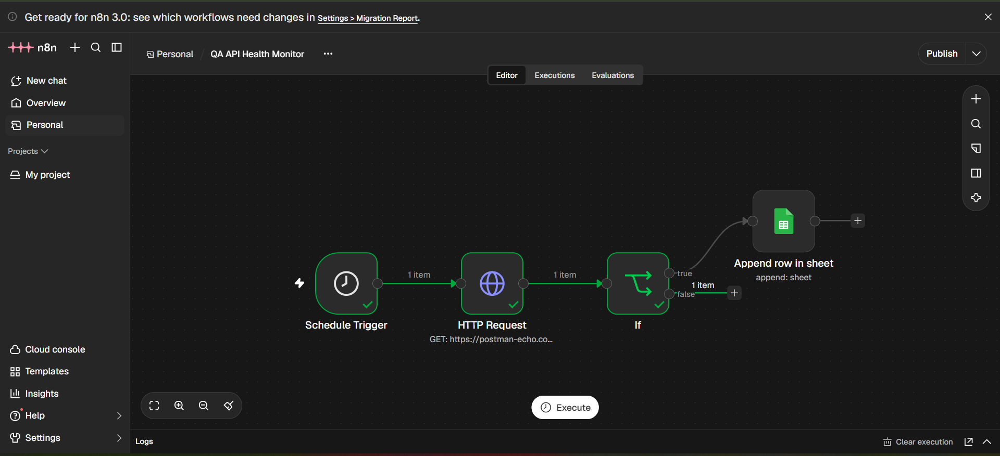
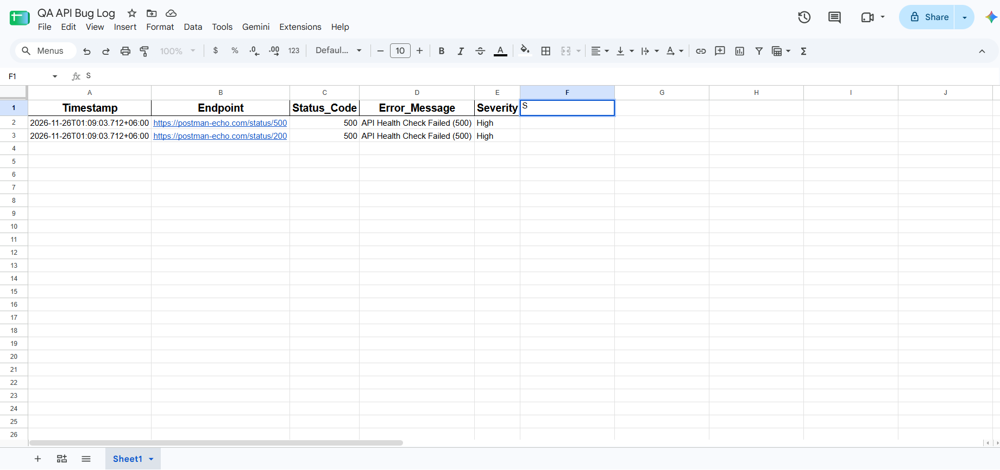

# Automated API Health Monitor & Bug Logger (n8n)

An automated Software Quality Assurance (SQA) workflow built in **n8n** that monitors API endpoint availability on a schedule, detects non-`200` HTTP status codes, and logs structured bug reports into **Google Sheets**.

## Workflow Canvas

## Architecture & Node Flow
`Schedule Trigger` → `HTTP Request` → `If (Status ≠ 200)` → `Google Sheets (Append Row)`

1. **Schedule Trigger:** Runs automated health checks at scheduled intervals (`Asia/Dhaka`, UTC+6).
2. **HTTP Request:** Sends `GET` requests to target endpoints (`https://postman-echo.com/status/500`) with **Never Error** and **Include Response Headers and Status** enabled so `4xx`/`5xx` responses are captured as structured JSON rather than halting the run.
3. **If Node (QA Pass/Fail Gate):** Evaluates `{{ $json.body.status }} != 200`. Healthy `200 OK` checks exit via the `false` branch; failing responses route to `true`.
4. **Google Sheets Logger:** Appends `Timestamp`, `Endpoint`, `Status_Code`, `Error_Message`, and `Severity` to the `QA API Bug Log` spreadsheet.

## Automated Bug Log Output

## How to Import & Run
1. Download `workflow.json` from this folder.
2. In n8n, create a new workflow, click **`...` → Import → From file**, and select `workflow.json`.
3. Connect your Google Sheets OAuth credential and select your target bug-log sheet.
